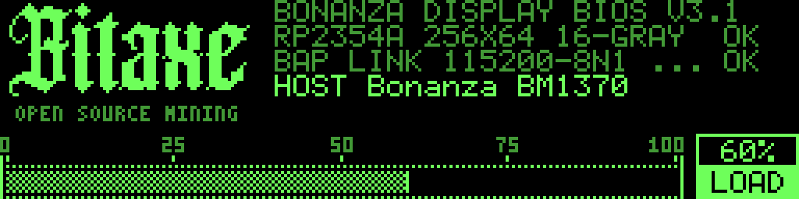
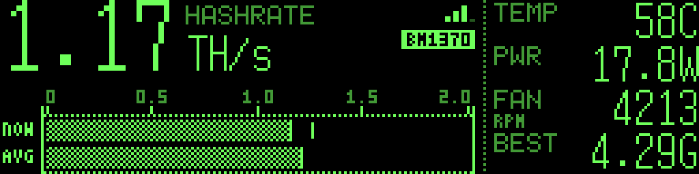
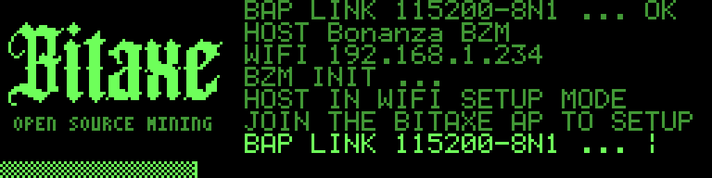
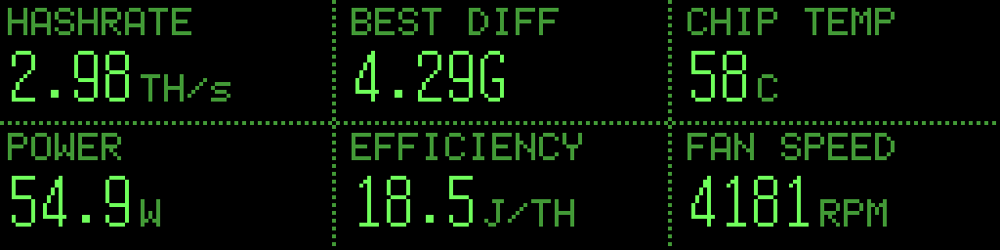
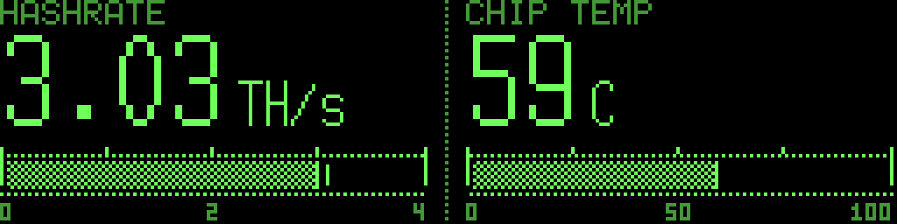
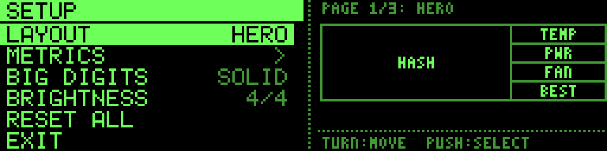
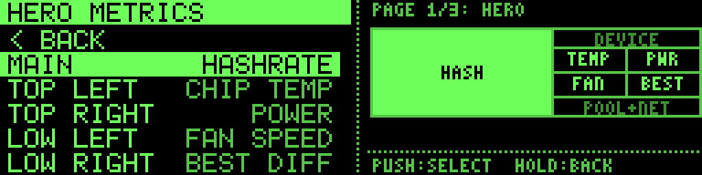
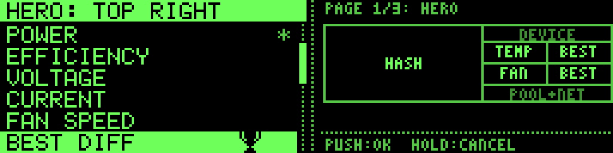

# bonanzaDisplay-fw




Firmware for driving a **SSD1322-based 256×64 OLED display** from an **RP2354A (RP2350 family)** on the [bitaxeBonanza display board](https://github.com/bitaxeorg/bonanzaDisplay) using the **LVGL** graphics library.

The display runs a **retro pixel UI** with three modes: a loading screen while
the bitaxe starts up, mining pages once it is hashing, and a setup menu,
driven by the dial switch, that chooses which metrics the mining pages show.
See [Using the display](#using-the-display).

The screens are plain C in `ui/app`, drawn into a framebuffer that LVGL
blits to the panel. The `ui` directory is also an **LVGL Editor / LVGL Pro
project**, which is where the fonts and the Bitaxe logo come from.

The display is connected through an **8080 8-bit parallel interface**. The CPU
packs LVGL's L8 framebuffer into the SSD1322's 4bpp format, then DMA and PIO
perform the hardware-timed transfer.

## Features

- **SSD1322 256×64 OLED** — 4-bit grayscale (16 shades)
- **8080 parallel bus** via PIO hardware — ~2.9 MHz byte rate
- **DMA + PIO** transfer the packed framebuffer with no CPU-driven bus writes
- **LVGL 9.x** rendering — L8 (8bpp) with automatic 4bpp packing
- **Double-buffered** full-screen render mode
- **Px437 FMTowns and Portfolio** 1bpp bitmap fonts shared with `bitaxe-lcd`
- **Retro UI**: loading screen, three mining pages, and a dial-driven setup menu
- **Selectable metrics** for every slot of every mining page, saved in flash
- **Desktop simulator** and host tests; no board needed to work on the UI

## Using the display

The screenshots in this README come from the [simulator](#simulator), enlarged
four times, tinted like the green panel, and with each gray level drawn as
bright as it looks on the panel. Each is the full 256×64 display.

| Mode | When | What it shows |
| --- | --- | --- |
| **Loading** | From power-up until the host is connected and hashing; again whenever the host restarts, enters WiFi setup, or stops responding | A twinkling Bitaxe logo, a typed-out start-up log that follows the real BAP link, and a checkered progress bar along the bottom |
| **Mining** | While the host is connected | One of three pages of live metrics |
| **Setup** | After pushing the dial | Menus on the left, a live preview of the result on the right |

The logo shimmers while this screen is up: it rests dim, a band of brightness
drifts through it, and individual pixels flare to full white and fade, each on
its own schedule and lighting their neighbours as they go.

The start-up log reads, in order:

| Line | Appears when |
| --- | --- |
| `BONANZA DISPLAY V0.1.0` | Power-up. The number is this firmware's [version](#firmware-version) |
| `BUILD e4cac89` | Power-up. The git revision the firmware was built from |
| `BAP LINK 115200-8N1 ... OK` | `OK` once the host first answers; a spinner until then |
| `HOST Bonanza BZM` | The host has reported its model and ASIC |
| `WIFI 192.168.1.234` | The host has joined WiFi and reported its address |
| `BZM INIT ... OK` | Shown with a spinner as soon as WiFi is up, because ESP-Miner only powers up and initialises the ASIC chain after that; `OK` when hashrate first appears |
| `HASHING 3.00 TH/s` | First nonzero hashrate; the mining screen follows a moment later |

A host restart, WiFi setup mode, or a lost link adds its own line (`HOST
RESTARTING`, `HOST IN WIFI SETUP MODE`, `HOST LINK LOST`) and starts the
sequence again from the link line. If the host is connected for 25 seconds
without reporting any hashrate, the log says `NO HASHRATE YET. STANDBY` and
the mining screen is shown anyway.

| Loading | Loading, host in WiFi setup mode |
| --- | --- |
|  |  |

### Dial controls

| Screen | Turn | Push | Push and hold |
| --- | --- | --- | --- |
| Mining | Flip between pages | Open setup | — |
| Loading | — | Open setup | — |
| Setup menu | Move the highlight | Select | Back one level; leave setup from the top menu |
| Setup picker | Try each option live | Keep it | Cancel and restore the old value |

The setup menu closes by itself after 30 seconds without input. Settings are
written to flash when setup closes, and three seconds after the last page
flip, so they survive power cycles and firmware updates.

### Mining pages

| Page | Slots | Layout |
| --- | --- | --- |
| `HERO` | 5 | One big metric with a scrolling graph of its last ten minutes; beside it a device line (host name, WiFi signal bars, ASIC model), four icon metrics, the stratum host, and the network difficulty |
| `GRID` | 6 | Six equal metrics, three by two |
| `DUO` | 2 | Two big metrics, each with a bar meter and a marker at its ten-minute peak |

The `HERO` graph scrolls from right to left, one column every five seconds,
with the live value in the last column. Its vertical scale fits the values in
view, and the two numbers beside it are the top and bottom of that scale in
the unit shown. Time when the host was away shows as a gap. Text metrics such
as the pool or IP address have no graph; the space shows the host and its IP
address instead.

The big metric is in dot-matrix digits, with its name beside the top of them
and its unit on their baseline. The four side metrics are a two-by-two block, each on one line: an icon, the
value in the small font, and the unit in the tiny font (`58 C`, `4136 RPM`,
`18.1 J/TH`). A value too long for that loses its unit, then drops to the tiny
font itself. The metric picker shows the icon of the highlighted metric, so it
doubles as the key to them.

Under the block, two fixed lines show the stratum host (server icon) and the
network difficulty (globe icon). They are not slots: they are always on the
`HERO` page. A host name longer than 15 characters is shown in the tiny font.
The network difficulty reads `--` until the host reports it; see
[Dashboard data and units](#dashboard-data-and-units).

Above the block, the device line shows the host name and ends with the WiFi
signal bars and the ASIC badge. Until the host reports its name the line
shows the device family instead.

The `DUO` bar meters auto-range to a round full scale above the highest value
seen since power-up; temperatures use a fixed 0–100 scale.

| `HERO` | `GRID` | `DUO` |
| --- | --- | --- |
|  |  |  |

### Setup menu

```text
SETUP
├── LAYOUT       HERO / GRID / DUO             which page is shown
├── METRICS      one entry per slot of that page; each opens a metric picker
├── BRIGHTNESS   1 LOW .. 4 HIGH               panel contrast current
├── RESET ALL    asks first; restores the default pages and metrics
└── EXIT
```

| Setup | Metrics of the current page |
| --- | --- |
|  |  |

| Metric picker |
| --- |
|  |

Each page keeps its own metric choices. Any slot can show any of these, or be
left empty:

| Metric | Shown as | Source |
| --- | --- | --- |
| Hashrate | `1.21 TH/s`, or `512 GH/s` below 1 TH/s | `hashrate` |
| Chip temp, VR temp | `58 C` | `chipTemp`, `vrTemp` |
| Power | `17.6 W` | `power` |
| Efficiency | `14.5 J/TH` | Power divided by hashrate, on the display |
| Voltage, Current | `5.02 V`, `3.51 A` | `voltage`, `current` (input side) |
| Fan speed | `4200 RPM` | `fan_speed` |
| Best diff | `4.29G` | `best_difficulty` |
| Shares, Rejected | `1532`, `4` | `shares` |
| Block height | `921034` | `block_height` |
| WiFi signal | `-58 dBm` | `wifi_rssi` |
| IP address, Pool, ASIC model | text | `wifi_ip`, `pool`, `asicModel` |
| Frequency | `-- MHz` until a host reports it | `frequency` |
| Network diff | `129.44T`, or `--` until a host reports it | `networkDifficulty` |

## Hardware

### Components

The [bonanzaDisplay](https://github.com/bitaxeorg/bonanzaDisplay) v3 hardware
connects to bitaxeBonanza-1004x through a 12-pin FFC carrying power, UART,
GPIO, and SWD. The RP2354A handles the OLED and encoder locally; ESP-Miner
supplies dashboard data using the Bitaxe Accessory Protocol (BAP).
This firmware targets v3 UART hardware; the previous v2 I2C register protocol
is no longer built.

### Wiring — RP2350 to SSD1322 Display

| RP2350 | GPIO   | Signal | Display Pin | Description |
|------- |--------|--------|-------------|-------------|
| Pin 2  | GPIO0  | D0     | 13 (D0)     | Data bit 0 |
| Pin 3  | GPIO1  | D1     | 12 (D1)     | Data bit 1 |
| Pin 4  | GPIO2  | D2     | 11 (D2)     | Data bit 2 |
| Pin 5  | GPIO3  | D3     | 10 (D3)     | Data bit 3 |
| Pin 7  | GPIO4  | D4     | 9 (D4)      | Data bit 4 |
| Pin 8  | GPIO5  | D5     | 8 (D5)      | Data bit 5 |
| Pin 9  | GPIO6  | D6     | 7 (D6)      | Data bit 6 |
| Pin 10 | GPIO7  | D7     | 6 (D7)      | Data bit 7 |
| Pin 12 | GPIO8  | RES#   | 20 (RES#)   | Reset (active low) |
| Pin 13 | GPIO9  | CS#    | 19 (CS#)    | Chip select (active low) |
| Pin 14 | GPIO10 | DC#    | 18 (D/C#)   | Data/Command select |
| Pin 15 | GPIO11 | R/W#   | 15 (R/W#)   | Write strobe (active low) |
| Pin 16 | GPIO12 | E/RD#  | 14 (E/RD#)  | Read strobe (active low) |

> **Note:** The display is configured for **8080 parallel mode**

### Dial Switch
The bonanzaDisplay has a SIQ-02FVS3 push-button jog wheel on it for interacting with the display. It is connected to the RP2350:

| Dial Switch Pin  | Function     | RP2350 | GPIO   |
|------------------|--------------|--------|--------|
| Counterclockwise | Quadrature A | Pin 19 | GPIO15 |
| Clockwise        | Quadrature B | Pin 17 | GPIO13 |
| Switch           | Push switch  | Pin 18 | GPIO14 |

The Counterclockwise and Clockwise pins are active-low quadrature phases. Both phase pins use pull-ups and connect to COM/GND through the dial contacts as the wheel rotates. Direction is decoded from the A/B phase sequence across a full detent. The Switch pin is also active-low and connects to COM/GND while the dial is pressed.

## bonanzaDisplay control interface

The display is a BAP accessory on **UART1, 115200 baud, 8 data bits, no parity,
one stop bit, no flow control**, using 3.3 V logic. USB is used for debug logs;
no debug text is sent over the BAP UART.

### Pinout and signal direction

The schematic's `DISP_TX` and `DISP_RX` net names are **host-relative**. The
12-pin FFC reverses pin numbering between the display and host connectors.
These directions were checked against both v3 display and Bonanza-1004x
exported netlists and ESP-Miner's `CONFIG_GPIO_BAP_TX=39`,
`CONFIG_GPIO_BAP_RX=40` configuration:

| Direction | Display GPIO / UART1 | Display J5 | Host J5 | ESP32 GPIO |
| --- | --- | --- | --- | --- |
| Display TX → host RX (`DISP_RX`) | GPIO20 / TX | 9 | 4 | GPIO40 / RX |
| Host TX → display RX (`DISP_TX`) | GPIO21 / RX | 8 | 5 | GPIO39 / TX |
| Reserved GPIO1 | GPIO22 | 5 | 8 | GPIO42 |
| Reserved GPIO2 | GPIO23 | 6 | 7 | GPIO41 |

GPIO22 and GPIO23 are unused by this firmware. The existing OLED and encoder
GPIO assignments are unchanged.

### BAP protocol

The **host** is ESP-Miner on the bitaxe; the **accessory** is bonanzaDisplay.
The display initiates requests and subscriptions. The host replies with
individual data fields. There is no I2C address or register map on this link.

#### Message format and checksum

```text
$BAP,<COMMAND>,<PARAMETER>[,<VALUE>]*HH\r\n
```

| Part | Meaning |
| --- | --- |
| `$` | Start of a new sentence |
| `BAP` | Protocol identifier |
| `COMMAND` | Case-sensitive command, such as `REQ`, `SUB`, or `RES` |
| `PARAMETER` | Case-sensitive request group or response field |
| `VALUE` | Optional for requests; required for responses used by the display |
| `*HH` | XOR checksum as exactly two hexadecimal digits |
| `\r\n` | Carriage return followed by line feed, bytes `0x0D 0x0A` |

In the examples below, `\r\n` represents those two bytes, not four literal
characters. Do not include the direction labels when sending a sentence.
The receiver also accepts LF-only line endings. Frames use printable ASCII;
there is no quoting or escape mechanism for embedded `$`, `*`, CR, or LF.
Keep complete CRLF frames within the client's 256-byte receive limit.

Start the checksum at zero and XOR every ASCII byte after `$` and before `*`,
including `BAP` and every comma. Exclude `$`, `*`, the checksum digits, and the
line ending. Both uppercase and lowercase checksum digits are accepted; the
display sends uppercase digits. For example, `BAP,REQ,systemInfo` has checksum
`3E`, giving `$BAP,REQ,systemInfo*3E\r\n`.

This Python helper produces the bytes to write to a serial port:

```python
def bap_frame(command, parameter, value=None):
    body = f"BAP,{command},{parameter}"
    if value is not None:
        body += f",{value}"
    checksum = 0
    for byte in body.encode("ascii"):
        checksum ^= byte
    return f"${body}*{checksum:02X}\r\n".encode("ascii")
```

The display validates checksums before applying data. Fragmented sentences
and several sentences in one UART read are supported. An incomplete sentence
is abandoned when a new `$` arrives. Invalid checksums, oversized sentences,
malformed values, and unknown response fields are ignored. UART overruns or
receive errors discard buffered input and restart framing at the next `$`.

#### Commands used by bonanzaDisplay

| Command | Direction | Behavior |
| --- | --- | --- |
| `REQ` | Display → host | Request `systemInfo`; no value is sent |
| `SUB` | Display → host | Subscribe to a group, with update interval in milliseconds |
| `RES` | Host → display | Supply one field from a request or subscription |
| `ACK` | Host → display | Acknowledge a subscription; `subscribed` is the normal value |
| `ERR` | Host → display | Report an error; does not update metrics or mark the display connected |
| `CMD` | Host → display | `mode,ap_mode` clears metrics and shows `Host WiFi AP` |
| `STA` | Host → display | `status,restarting` clears metrics; `subscription_timeout` schedules renewal |

Only recognized, valid `RES` fields update metrics and the connection's last
response time. ACK values are not telemetry. The current accessory sends no
`SET`, `UNSUB`, or miner-control commands. The dial only changes what the
display shows; it never changes host settings.

#### Requests, subscription groups, and response fields

A request or subscription group can produce several `RES` sentences, each
with its own parameter name. In particular, subscribe to **`temperature`** to
receive **`chipTemp`**, and subscribe to **`wifi`** to receive **`wifi_ip`**.

| Display command | Fields returned by the current host | Fields displayed |
| --- | --- | --- |
| `REQ,systemInfo` | `deviceModel`, `asicModel`, `pool`, `poolPort`, `poolUser` | `deviceModel`, `asicModel`, `pool` |
| `SUB,hashrate,1000` | `hashrate` | `hashrate` |
| `SUB,temperature,1000` | `chipTemp`, `vrTemp` | `chipTemp`, `vrTemp` |
| `SUB,power,1000` | `power` | `power` |
| `SUB,fan_speed,1000` | `fan_speed` | `fan_speed` |
| `SUB,best_difficulty,1000` | `best_difficulty` | `best_difficulty` |
| `SUB,wifi,1000` | `wifi_ssid`, `wifi_password`, `wifi_rssi`, `wifi_ip` | `wifi_rssi`, `wifi_ip` |
| `SUB,voltage,1000` | `voltage` | `voltage` |
| `SUB,current,1000` | `current` | `current` |
| `SUB,shares,1000` | `shares` | `shares` |
| `SUB,block_height,1000` | `block_height` | `block_height` |

Which of these appear on screen depends on the metrics chosen in setup; the
display always subscribes to all of them.

The WiFi subscription includes the host's password in the current ESP-Miner
implementation. The display ignores it and never logs received sentences;
unused fields remain only in transient receive buffers.

The startup sequence is sent in this order, beginning one second after UART
initialization and spacing commands at least 100 ms apart:

```text
$BAP,REQ,systemInfo*3E\r\n
$BAP,SUB,hashrate,1000*2A\r\n
$BAP,SUB,temperature,1000*56\r\n
$BAP,SUB,power,1000*45\r\n
$BAP,SUB,fan_speed,1000*6B\r\n
$BAP,SUB,best_difficulty,1000*76\r\n
$BAP,SUB,wifi,1000*2B\r\n
$BAP,SUB,voltage,1000*58\r\n
$BAP,SUB,current,1000*53\r\n
$BAP,SUB,shares,1000*24\r\n
$BAP,SUB,block_height,1000*13\r\n
```

A representative subscription exchange is:

```text
Display → host:  $BAP,SUB,temperature,1000*56\r\n
Host → display:  $BAP,ACK,temperature,subscribed*56\r\n
Host → display:  $BAP,RES,chipTemp,58.250000*21\r\n
Host → display:  $BAP,RES,vrTemp,47.000000*3E\r\n
Display → host:  $BAP,SUB,fan_speed,1000*6B\r\n
Host → display:  $BAP,ACK,fan_speed,subscribed*6B\r\n
Host → display:  $BAP,RES,fan_speed,4200*6C\r\n
```

This exchange supplies chip temperature `58`, VR temperature `47` and fan
speed `4200`; the ACKs are ignored.
Other metric updates may be interleaved. Responses update their own field
and preserve the last values of other fields; BAP does not provide an atomic
snapshot of the entire dashboard.

#### Dashboard data and units

Numeric values arrive as ASCII without unit suffixes. The client accepts
finite, nonnegative values that fit its unsigned 32-bit metric representation
and rounds to the nearest integer. Negative, non-finite, overflowing, and
partially parsed numeric values are rejected.

| BAP response field | Example wire value | Dashboard value |
| --- | --- | --- |
| `deviceModel` | `Bonanza` | Device family |
| `asicModel` | `BM1370` | ASIC model beside the family |
| `wifi_ip` | `192.168.1.234` | Host IPv4 address |
| `hashrate` | `1200.55` | `1201GH/s`; rates ≥10,000 GH/s use TH/s with one decimal place |
| `chipTemp` | `58.250000` | `58C` |
| `power` | `17.60` | `18W` |
| `fan_speed` | `4200` | `4200RPM` |
| `best_difficulty` | `123T` | Host-formatted best share string |
| `vrTemp` | `47.000000` | `47C` |
| `voltage` | `5020.00` | Millivolts on the wire; shown as `5.02V` |
| `current` | `3506.25` | Milliamps on the wire; shown as `3.51A` |
| `shares` | `1532/4` | Accepted and rejected counts, as two metrics |
| `block_height` | `921034` | Block height |
| `wifi_rssi` | `-58` | `-58dBm`, and the signal bars on the `HERO` page |
| `pool` | `public-pool.io` | Stratum host name |
| `networkDifficulty` | `129.44T` | Host-formatted network difficulty string |
| `hostname` | `bitaxe` | Host name on the `HERO` device line |

`networkDifficulty` and `hostname` are not part of ESP-Miner's BAP today. The
display reads them from the `systemInfo` response, which it requests every ten
seconds, so a host only has to add two lines beside `pool` there: its
`network_diff_string` and its configured host name. Until it does, the
display shows `--` for the difficulty and the device family for the name. The
exact host change is written up in [`docs/host-bap-todo.md`](docs/host-bap-todo.md).

These units follow the host implementation: hashrate is **GH/s**, and the
`fan_speed` subscription reports **RPM**. A BAP `SET,fan_speed` command uses
percent and its ACK can contain percent; that value must not be interpreted
as subscription telemetry.

`power` is kept to the milliwatt as well as rounded to whole watts, so the
display can show tenths and compute efficiency. `shares` must be two unsigned
integers separated by `/`, and `wifi_rssi` an integer of at most three digits
with an optional leading minus sign; anything else is ignored.

ESP-Miner currently does not emit board revision, hostname, or frequency over
BAP, so the frequency metric remains `--`. A future unsolicited
`RES,frequency,<MHz>` response is supported. Unknown or unreceived metrics
show `--`. Family, ASIC model, IP address, best-share, and pool strings are
truncated to 31, 15, 15, 31, and 47 characters, respectively.

#### Subscription renewal and reconnects

| Event | Display behavior |
| --- | --- |
| Startup | Show the loading screen; send the initial request/subscription sequence after one second |
| Valid recognized `RES` | Update that field and mark the link connected; the loading screen moves on to mining once hashrate is nonzero |
| Connected, every 10 seconds | Request `systemInfo` to check liveness even when telemetry is unchanged |
| Connected, 60 seconds after a subscription sequence finishes | Repeat the request/subscription sequence to renew subscriptions |
| No recognized responses for 30 seconds | Clear stale metrics and return to the loading screen (`HOST LINK LOST`) |
| Disconnected, 10 seconds after a sequence finishes | Retry the request/subscription sequence, including when the first attempt received no replies |
| `CMD,mode,ap_mode` | Clear metrics and show the loading screen in its `SETUP` state; retry until normal host responses resume |
| `STA,status,restarting` | Clear metrics and show the loading screen (`HOST RESTARTING`); retry until normal host responses resume |
| `STA,<parameter>,subscription_timeout` | Make subscription renewal due on the next client service call |

The host only sends changed subscription values. The requested 1000 ms
interval controls update checks; it does not guarantee one response per
second. Repeating `SUB` refreshes the host's five-minute subscription timeout
and causes the current value to be sent again. A subscription ACK alone does
not prove that metric data has arrived.

In host AP mode, ESP-Miner rejects normal requests and subscriptions with
`ERR,<parameter>,ap_mode_no_requests` or
`ERR,<parameter>,ap_mode_no_subscriptions`. The accessory ignores these errors
and keeps retrying. The periodic AP-mode command supplies the visible status.
All LVGL updates run in the main loop; the UART interrupt only buffers bytes.

This describes the implemented bonanzaDisplay subset of BAP. The matching
sources are [the portable client](src/control/bap_client.c),
[the UART transport](src/control/bap_control.c), and ESP-Miner's `main/bap`
host code. The [BAP-GT-TOUCH accessory](https://github.com/bitaxeorg/BAP-GT-TOUCH)
is another implementation of the same protocol.

## Building

### Prerequisites

- [Pico SDK 2.x](https://github.com/raspberrypi/pico-sdk) installed at `~/pico-sdk` (or set `PICO_SDK_PATH`)
- `arm-none-eabi-gcc` toolchain
- `cmake` and a supported build backend such as Make or Ninja
- [picotool](https://github.com/raspberrypi/picotool) for flashing

### Build

```bash
export PICO_SDK_PATH=/path/to/pico-sdk
cmake -S . -B build-v3-rp2354a -DPICO_BOARD=pico2 -DPICO_FLASH_SIZE_BYTES=2097152
cmake --build build-v3-rp2354a -j
```

The RP2354A has 2 MiB of internal flash; the explicit flash-size setting
overrides the Pico 2 board profile's larger default.

### Firmware version

The version number is the single line in the [`VERSION`](VERSION) file. The
build also records the git revision it was configured from (with `-dirty` if
there were uncommitted changes). Both appear on the loading screen, at the
start of the USB debug log, and in `picotool info`:

```text
 name:          bonanzaDisplay
 version:       0.1.0 (e4cac89)
```

The revision is read when CMake configures the build, so re-run `cmake` after
committing if the build id matters. Editing `VERSION` reconfigures by itself.

### Simulator

The UI and the BAP client run on the desktop against a pretend ESP-Miner
host, with no Pico SDK, LVGL, or board:

```bash
./tools/sim.sh
```

That opens a window (SDL2 required, `brew install sdl2`). Left/Right turn the
dial and Space is the push switch; `B` boots the host, `U` brings it straight
up, `A` puts it in WiFi setup mode, `R` restarts it, `O` turns it off, and `P`
power-cycles the display.

With arguments, the same simulator runs a script on a virtual clock and
writes PNGs, which is how the images in `docs/screens` are made:

```bash
./tools/sim.sh tint:green host:boot run:9000 shot:/tmp/mining.png click run:200 shot:/tmp/setup.png
```

The steps are listed at the top of [`sim/sim_main.c`](sim/sim_main.c).

### Tests

Run the host-side tests without the Pico SDK or a connected board:

```bash
./tools/test_bap.sh
```

```bash
./tools/test_ui.sh
```

```bash
./tools/test_ui_lvgl.sh
```

All three use AddressSanitizer and UndefinedBehaviorSanitizer.

- `test_bap.sh` covers framing/checksum rejection, fragmented input, field
  names and units, retry and renewal timing, timer wraparound, and stale-data
  clearing.
- `test_ui.sh` drives the UI state machine through the dial: loading to mining
  and back, every setup menu, cancel and timeout, saved settings across a
  power cycle, rejected settings blobs, timer wraparound, and drawing every
  metric in every slot of every page.
- `test_ui_lvgl.sh` builds LVGL for the host with the firmware's `lv_conf.h`
  and checks that what LVGL flushes to the panel is exactly the UI's
  framebuffer on the loading screen, every mining page, and the setup menu.
  The first run compiles LVGL and takes a minute or two.

The physical UART, panel, dial, flash storage, and brightness control still
require a board test.

### Flash

```bash
picotool load build-v3-rp2354a/bonanzaDisplay.uf2 -f && picotool reboot
```

Or hold BOOTSEL while connecting USB, then drag `build-v3-rp2354a/bonanzaDisplay.uf2` to the mounted drive.

## Fonts and logo: the LVGL Editor project

The loading screen, mining pages, and setup menu are C code in `ui/app`;
preview them with the [simulator](#simulator). The `ui` directory is still an
LVGL Editor project, and it is the source of the two fonts and the Bitaxe
logo:

1. Install LVGL Editor or the official VS Code extension. The project is known
   to work with extension 1.0.1; using the latest available version is
   recommended.
2. Open `bonanzaDisplay-fw.code-workspace`. Its first workspace folder is
   `ui`, which puts `globals.xml` and `project.xml` at the root expected by the
   editor. Opening the `ui` directory by itself also works.
3. If the extension was already running, use **Developer: Reload Window** once.
4. Open LVGL Editor and select the `pico2w_ssd1322` target. The preview is
   configured for the physical **256×64 L8 grayscale** display.
5. Change the fonts or images in `globals.xml`, then choose **Compile and
   export code**.
6. Regenerate the fixed-cell copies that `ui/app` draws with, and rebuild:

```bash
python3 tools/gen_ui_assets.py
```

Keep the `ui/fonts` and `ui/images` directories present. LVGL Editor's
containerized resource converter mounts both directories. The images directory
contains the Bitaxe logo source PNG and its generated L8 C data.

The UI uses the same Px437 FMTowns 8×16 and Portfolio 6×8 fonts as
`bitaxe-lcd`. With LVGL Editor 1.0.x, asset filenames must not contain spaces
because its resource-converter command does not quote font paths.

Files ending in `_gen.c` or `_gen.h`, plus `file_list_gen.cmake`, are owned by
LVGL Editor and may be overwritten. Put persistent C code in `bonanza_ui.c`,
`bonanza_ui.h`, or add extra sources in `user_config.cmake`.

`ui/screens/main_screen.xml` is the earlier editor-designed dashboard, with
its subjects in `globals.xml`. It is still part of the editor project, but the
firmware no longer shows it. Keep all LVGL calls on the same core/thread as
`lv_timer_handler()` unless synchronization is added.

### Preview troubleshooting

- LVGL Editor 1.0.x does not quote resource paths correctly, so font and image
  filenames must not contain spaces.
- If the preview refers to an asset that has been removed or renamed, close the
  preview, remove `ui/preview-bin` and `ui/preview-build`, then click the hammer
  to build a fresh runtime. These directories are generated and ignored by Git.
- Screen zoom is not persisted by LVGL Editor 1.0.1. A persistent `<preview
  zoom="200%">` is supported for components and widgets, but not screens. VS
  Code's `window.zoomLevel` can enlarge the whole editor as a workaround.

## Project Structure

```
bonanzaDisplay/
├── .gitignore                  # Build, firmware, and editor-cache exclusions
├── bonanzaDisplay-fw.code-workspace # Opens UI at the LVGL Editor project root
├── CMakeLists.txt              # Top-level build configuration
├── VERSION                     # Firmware version number
├── config/
│   ├── lv_conf.h               # LVGL configuration
│   └── pin_config.h            # GPIO pin assignments
├── src/
│   ├── main.c                  # Entry point, hardware init, and live UI data
│   ├── control/
│   │   ├── bap_client.c        # Portable BAP parser, metrics, and subscriptions
│   │   ├── bap_client.h        # Client state and metrics snapshot
│   │   ├── bap_control.c       # UART1 IRQ receive buffer and main-loop service
│   │   ├── bap_control.h       # Firmware-facing control interface
│   │   └── bap_ui_bridge.h     # BAP metrics snapshot -> UI data model
│   ├── display/
│   │   ├── ssd1322.c           # SSD1322 driver (PIO + DMA + bitbang)
│   │   ├── ssd1322.h           # Driver public API
│   │   ├── ssd1322_regs.h      # Register definitions and geometry
│   │   └── parallel_8080.pio   # PIO program for 8080 bus
│   ├── fonts/
│   │   └── lv_font_portfolio_6x8.c # LVGL default/fallback font
│   ├── input/
│   │   ├── dial_switch.c       # Jog-wheel decoding and debounce
│   │   └── dial_switch.h
│   ├── lvgl_port/
│   │   ├── lv_port_disp.c      # LVGL display driver (L8 → 4bpp → DMA)
│   │   └── lv_port_disp.h
│   └── storage/
│       └── settings_store.c    # Display settings in the last flash sector
├── sim/
│   └── sim_main.c              # Desktop simulator with a pretend BAP host
├── tests/                      # Host tests: BAP client, UI, LVGL glue
├── tools/
│   ├── sim.sh                  # Build and run the simulator
│   ├── test_bap.sh, test_ui.sh, test_ui_lvgl.sh
│   └── gen_ui_assets.py        # Editor fonts/logo -> ui/app/bz_assets_data.c
├── ui/                         # LVGL Editor / LVGL Pro project
│   ├── project.xml             # 256×64 L8 target definition
│   ├── globals.xml             # Fonts, logo, and observable subjects
│   ├── fonts/                  # Source TTFs and editor-generated font data
│   ├── images/
│   │   ├── bitaxe_logo.png     # Editable logo source
│   │   └── bitaxe_logo_data.c  # Editor-generated L8 image data
│   ├── screens/
│   │   ├── main_screen.xml     # Earlier editor dashboard; no longer shown
│   │   └── main_screen_gen.c   # Its editor-generated source
│   ├── app/                    # Retro UI: plain C, no LVGL or Pico SDK
│   │   ├── bz_app.c            # Modes, dial input, settings, metric history
│   │   ├── bz_boot.c           # Loading screen
│   │   ├── bz_mining.c         # HERO, GRID and DUO pages, graph and bar meters
│   │   ├── bz_menu.c           # Setup menu
│   │   ├── bz_model.c          # Metric catalogue and settings blob
│   │   ├── bz_gfx.c            # Framebuffer drawing and bitmap text
│   │   ├── bz_icons.c          # 9x9 metric icons, drawn as text in the source
│   │   └── bz_assets_data.c    # Generated fixed-cell fonts and logo
│   ├── bonanza_ui.c            # LVGL glue: shows the retro UI framebuffer
│   ├── bonanza_ui_gen.c        # Editor-generated subjects/assets setup
│   ├── file_list_gen.cmake     # Editor-generated source manifest
│   ├── user_config.cmake       # Adds ui/app to the UI library
│   └── CMakeLists.txt          # Builds exported UI as lib-ui
└── lib/
    └── lvgl/                   # LVGL 9.x (git submodule)
```

## Architecture

```
┌───────────┐   ┌─────────────┐    ┌──────────────┐    ┌───────────┐    ┌──────────┐
│ Retro UI  │──►│  LVGL 9.x   │───►│ L8 → 4bpp    │───►│    DMA    │───►│   PIO    │
│ (ui/app)  │   │  (render)   │    │  (packing)   │    │ (transfer)│    │ (8080)   │
└───────────┘   └─────────────┘    └──────────────┘    └───────────┘    └────┬─────┘
                                                                             │ 8-bit
                                                                             ▼ parallel
                                                                        ┌──────────┐
                                                                        │ SSD1322  │
                                                                        │  OLED    │
                                                                        └──────────┘
```

1. The **retro UI** draws each frame into its own 256×64 L8 framebuffer.
   LVGL shows that through one full-screen image, rendered into an L8
   (8-bit luminance) double buffer.
2. The CPU-side **flush callback** packs L8 → 4bpp by taking each pixel's upper
   nibble and combining two adjacent pixels per byte.
3. **DMA** transfers the packed buffer to the PIO TX FIFO without CPU-driven
   bus writes.
4. **PIO** clocks out each byte with hardware-timed WR# strobes on the 8080 bus

## Grayscale and brightness

The OLED emits a single color but supports **16 brightness levels per pixel**.
LVGL renders 8-bit luminance and the flush callback reduces it to the SSD1322's
4-bit grayscale range. For predictable UI brightness, use neutral RGB values
with equal components:

```xml
text_color="0xffffff"  <!-- level 15: brightest -->
text_color="0xaaaaaa"  <!-- level 10 -->
text_color="0x777777"  <!-- level 7 -->
text_color="0x333333"  <!-- level 3 -->
text_color="0x000000"  <!-- level 0: off -->
```

Values from `0x000000`, `0x111111`, ... through `0xffffff` map naturally to
the 16 hardware levels. Colored preview values have no hue on the OLED; LVGL
converts them to luminance. The Bitaxe logo is converted to L8 in `globals.xml`,
and its displayed brightness can be adjusted with an `image_recolor` style
using a neutral grayscale value.

## Fonts

The editable UI uses the same 1bpp Px437 FMTowns 8×16 and Portfolio 6×8
fonts as `bitaxe-lcd`. Their source `.ttf` files and editor-generated C data
live in `ui/fonts`.

## License

GPL v3 -- FOSS || GTFO
